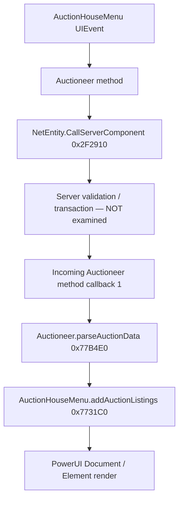

# Batch 04 — Auction house, bids, market buyouts and listing UI

**Evidence:** User-supplied Ghidra decompilation of `GameAssembly.dll` (export function ordinals **30,001–40,000**) plus the matching IL2CPP `dump.cs`. **Snapshot image base:** `0x180000000`; exact game-build fingerprint unverified. Native branches described below were inspected; **no server-side validation, economic transaction or in-game test has been verified**.

This is a technical reference for people developing inventory browsers, marketplace analytics, accessibility improvements, market-watch tools and private-server admin dashboards. **No prices or player market data are included.**

## 1. Separate gameplay, network and presentation layers

The **server transaction** and actual event timing in this diagram remain unverified; the direct native receive-and-render chain is supported by decompiled code. An outgoing client request must never be treated as a completed purchase.

## 2. Outgoing Auctioneer requests — four distinct component IDs

All four methods use the `Auctioneer`'s `myEntity` (field **`0x20`**) and `OrbusNetComponent` (field **`0x18`**) to reach `NetEntity.CallServerComponent` **RVA `0x2F2910`** (Batch 02). The **method IDs are scoped to this component**.

| Managed method | RVA | Observed outgoing ID | Outgoing data as constructed |
| --- | --- | ---: | --- |
| `Auctioneer.callServerItemSearch(string searchable)` | `0x77B120` | **1** | One search string, encoded into a typed outgoing payload. |
| `Auctioneer.callServerCategorySearch(string searchable)` | `0x77B020` | **2** | One category/search string, encoded into a typed outgoing payload. |
| `Auctioneer.Bid(string auctionId, string bid, int isBuyout)` | `0x77A650` | **3** | Auction ID, bid text and a 32-bit buyout indicator. The apparent `bid` value is a **string** at this client boundary; server numeric parsing is not established here. |
| `Auctioneer.marketBuyout(string marketContainerId, string itemid)` | `0x77B220` | **4** | Market container ID and item ID, both strings. |

**Important:** `AuctionHouseMenu.Buyout(UIEvent)` **`0x772D20`** also contains a visible direct method-4 network send in one UI branch. That does not make `Buyout` equivalent to `marketBuyout` in every UI state. Compare the selected listing and sale type in a private test before altering behavior.

### UI-to-network event entry points

| Menu method | RVA | Function |
|---|---|---|
| `AuctionHouseMenu.Bid(UIEvent)` | `0x772B90` | Extracts a price and listing ID from UI state, calls `Auctioneer.Bid`. |
| `AuctionHouseMenu.Buyout(UIEvent)` | `0x772D20` | Parses selected listing and optional confirmation/market mode, then sends a buyout-related request. |
| `AuctionHouseMenu.handleCategoryClick(UIEvent)` | `0x774950` | Updates selected category and menu state. |
| `AuctionHouseMenu.handleItemClick(UIEvent)` | `0x774B90` | Updates selected item and menu state. |
| `AuctionHouseMenu.refreshAuctionListings()` | `0x777830` | Rebuilds or refreshes the displayed market listing set. |
| `AuctionHouseMenu.sortItems()` | `0x777E90` | Constructs sorted view data from the client-side listing dictionary. |
| `AuctionHouseMenu.inventoryHover(UIEvent)` | `0x774F00` | Large (~46.7 kB Ghidra pseudocode) tooltip/presentation path; uses selected inventory/listing fields and DOM operations. |
| `AuctionHouseMenu.inventoryStopHover(UIEvent)` | `0x7774C0` | Tooltip cleanup/stop-hover path. |

## 3. Incoming results: replicated market state isn't a completed bid

`Auctioneer.orbusNetInit(NetEntity)` **`0x77B2F0`** registers:

- **one incoming component-method listener, ID 1**, via `NetEntity.RegisterListenerForMethod` `0x2F2EF0`;
- **one synchronized variable, index 1**, via `NetEntity.RegisterNetSyncVar` `0x2F3020`.

The incoming listener callback `Auctioneer.<>c.<orbusNetInit>b__23_0(ArrayList)` **`0x782C40`** reads an incoming response object, obtains its items array, copies them into a client-side collection, and invokes `AuctionHouseMenu.addAuctionListings` **`0x7731C0`**. Independently, `Auctioneer.parseAuctionData(AuctionHouseItemList)` **`0x77B4E0`** clears/rebuilds the same listing dataset from an array and calls the same listing renderer.

`Auctioneer.<orbusNetInit>b__23_1(object)` **`0x77AD70`** handles a separate synchronized value, storing it as the Auctioneer's errors/status text. **The mapping between every server error and bid/payment outcome is not yet decoded.**

**Lesson for mod authors:** market search results and local UI updates can occur before or without a successful bid. The correct success condition comes from authoritative server state and a completed transaction, not from an outgoing method call.

## 4. Auction listing item model

`AuctionHouseMenu.AuctionHouseItem` (IL2CPP `TypeDefIndex 7073`) stores:

| Field | Offset | Meaning from managed declaration |
|---|---:|---|
| `id` | `0x10` | Listing ID |
| `name` | `0x18` | Listed item name |
| `type` | `0x20` | Category/type label |
| `seller` / `bidder` | `0x28` / `0x30` | Display metadata; privacy-sensitive |
| `stackSize` | `0x38` | Stack quantity |
| `auctionLength` | `0x3C` | Duration/remaining field; units need checking |
| `bid` / `buyout` | `0x40` / `0x44` | Int values used by menu |
| `itemId` / `originalItem` | `0x48` / `0x50` | Item identifiers/descriptions |
| `invItem` | `0x58` | Rich `InventoryItemInstance` object |

The UI owns `Dictionary<int,AuctionHouseItem>` fields named `auctionhouseItems` and `sortedItems` and stores a static `Document`. **These dictionaries are cached view state, not the server's authoritative auction inventory.**

## 5. Posting auctions uses a different class and a 12-slot price input

`AuctionPostMenu.postItem(UIEvent)` **`0x7790C0`**:

1. Resolves selected inventory/slot position from the incoming UI element.
2. Creates **two integer arrays, each of length 12**.
3. Iterates all **12** input positions to read/parse the bid entries and corresponding buyout entries from document elements, using zero as a default when an input is absent.
4. Calls `AuctionChest.PostItem(int itemPosition, int[] newbids, int[] newbuyouts)` **`0x65A830`** (Batch 03).

The matching `AuctionChest` class has replicated inventory, bid, buyout, auction and error fields. The two length-12 arrays are **a client UI representation of entered prices**, not proof the server permits 12 simultaneous listings or a particular currency denomination. The server-side PostItem handler and permissions remain to be identified.

## 6. Safe modding and validation recipes

- **Read-only price tracker:** observe the processed listing items as returned from the server, cache anonymized price/quantity/type locally with timestamps, and show sorting/statistics without sending bids.
- **Accessible market search:** reuse existing input widgets and display results in a separate opt-in panel. Avoid changing `Auctioneer` component IDs or fake success.
- **Admin market explorer:** if operating your *own* server, derive legitimate market records from the server's persistence layer rather than trusting the client's cached dictionary.
- **Tooltip enhancement:** watch `inventoryHover`/stop-hover and inspect `AuctionHouseItem.invItem` for item stats and rarity, without mutating inventory or inventing metadata.
- **Test cases:** search by item vs category; bid below/current/above price; buyout with confirmation; empty/malformed price inputs; stale listing removed by another user. Record outgoing request, incoming response, changed server state and UI update separately.

**Status:** static-traced, not runtime-tested. **Unresolved:** real wallet/currency debit, error strings, listing expiry rules, trading taxes, permission checks, race conditions, live server persistence.
