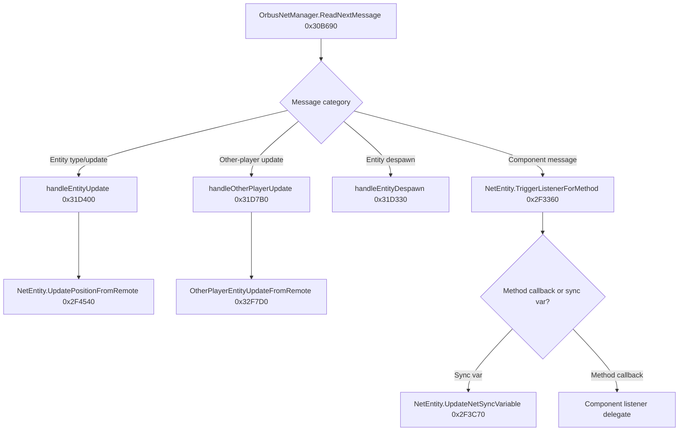

# Batch 02 — Deeper review of networking, NPCs, class logic and world lifecycle

**Date:** 2026-11-08. **Snapshot:** user-generated Ghidra `GameAssembly.dll` export, function ordinal range **10,001–20,000**; RVA approx **`0x13FB70`–`0x3233F0`**; image base **`0x180000000`**. **Exact binary build unverified.** This guide summarizes **static control-flow research**, *not* 10,000 runtime tests or proof that every native function has been understood.

## Scope and integrity

| Metric | Value |
|---|---:|
| Functions indexed | **10,000** |
| Successful decompilations | **9,999** |
| Timed-out decompilations | **1** (ordinal 19,850; RVA `0x30F330`, `OrbusNetManager..ctor()` in IL2CPP dump) |
| Pseudocode length in private index | **10,738,851 characters** |
| Distinct direct caller→callee relationships parsed | **29,432** |
| Relationships with callee address found inside Batch 02 | **22,034** |
| Distinct native target addresses referenced | **2,202** |
| Previously curated named-method entries overlapping this range | **120** across **98 distinct RVAs** |

**The first ~9,500 functions are heavily runtime, IL2CPP, compression, standard-library and support code.** The identifiable core gameplay/network manager cluster is concentrated near the end of the batch. Some of that supporting code can still matter for a real bug; don't classify a batch solely by names or keywords.

## Read the deep system guides

1. **[Incoming message parser and entity spawning](batch-02-incoming-message-parser-and-spawns.md)** — `OrbusNetManager.ReadNextMessage`, message-code ranges, GUID/type factory, other-player updates, entity destruction and full-list clearing.
2. **[Component dispatch and movement](batch-02-component-dispatch-and-entity-lifecycle.md)** — `NetEntity` outgoing request envelope, two registration maps, callbacks, generic motion, remote player pose and cleanup/pooling.
3. **[Connections, scenes and prefab pools](batch-02-connections-zone-loading-and-prefab-pools.md)** — ENet loops, connection/handshake, ping, initial position, scene activation, prefab caching, player-rig switching.
4. **[NPC dialogue and UI](batch-02-npc-dialogue-interaction-and-ui.md)** — two-second interaction throttle, the `DoDialog` outgoing path, five incoming listener registrations and transient dialogue widgets.
5. **[Orbhealer and target HUD](batch-02-orbhealer-healthbars-and-combat-ui.md)** — Musketeer-oriented orb/arrow pathways, outgoing class requests, `OrbusHealthBar` target level/tier logic and UI refresh.
6. **[Earlier targeted network/scene traces](batch-02-network-and-scenes-first-traces.md)** — initial observations retained for research provenance; the new guides supersede it where they add more precise names/callers.

For machine-readable method discovery, see [the 120 curated method entries](../references/batch-02-curated-methods.json). **Shared-RVA warning:** nineteen differently named metadata methods point at the same `0x2F1730` no-op stub. Metadata aliases are not independent implemented features.

## Highest-value concrete discoveries

### 1. The actual network receive→entity→callback path

This call chain is much more informative than merely knowing a class has an `orbusNetInit` method. **Not yet resolved:** why an authoritative server transmits or excludes a remote entity from a particular player's interest set.

### 2. Entity identity and pooling have real lifecycle consequences

Manager dictionaries/list entries, type-to-factory lookups, `ReturnToPool`, entity despawn and the `ClearAllEntities` receive path can all make scene objects disappear or be replaced. An offline replay should **record the prefab/mesh while available**, plus GUID, scene ID and last valid pose. Reusing a stale Unity object pointer after return-to-pool is unsafe.

### 3. Other players send richer pose data than a single root position

`handleOtherPlayerUpdate` `0x31D7B0` forwards to `OtherPlayerEntityUpdateFromRemote` `0x32F7D0` (Batch 03). Its companion per-frame method `0x32FDA0` processes multiple body/head/hand transform targets. Record **the actual remote avatar anchors**, not just one x/y/z.

### 4. Native preloading is prefab caching, not arbitrary distant world streaming

`PreloadForScene` warms named prefabs at count **1** and `ScenePreloader.Start` (Batch 03) warms its list at count **10**; neither proves the server will send distant terrain or actors to a camera-only observer. The actual scene loader, entity-interest rules and asset dependencies still need research.

### 5. NPCs, class abilities and health bars follow separate authority boundaries

- NPC `PlayerInteraction` has a **2.0-second local guard**, then `PlayerCharacter.DoDialog(ushort)` may send a player-component request.
- Orbhealer/Musketeer class has local projectile visuals, outbound method IDs **2–5** on various pathways and **eight** synchronized-variable registrations.
- `RelativeRatingForCurrentPlayer` groups level differences into **five display categories** with thresholds below `-3`, below `-1`, below `2`, below `4`, and above; these are **display labels**, not damage multipliers.
- `OrbusHealthBar.showBar/hideBar` toggle visibility and **mark a refresh flag**, rather than constructing a completed UI immediately.

## Practical investigation backlog

1. **World streaming:** find server interest-radius / area-subscription logic and the exact Unity scene asset source; current static client evidence does not establish either.
2. **Server request receivers:** map player and class component method IDs to actual handlers/validation/persistence on an authorized private server.
3. **Remote party replay:** log snapshots and replacement/despawn events across zone/instance swaps with two consenting test players.
4. **NPC choice state:** match incoming listener IDs to dialogue, choice and quest-state callbacks, then confirm server results.
5. **Damage and buffs:** use real combat log and server state rather than local arrow/note gesture effects for numeric values.
6. **Retry timed-out function:** `0x30F330` with higher Ghidra timeout, confirm constructor behavior and avoid guessing from its dump signature.

## Evidence policy and limitations

All named methods and addresses are **snapshot-mapped**; behavior summaries are supported by inspected native control flow. No live user/server validation has been carried out during this analysis. The decompiler may infer incomplete parameter lists; inspecting callers is often necessary. Only original, independently written explanations and small symbol metadata are public. The full pseudocode stays in the locally searchable private SQLite archive.

See [eight-batch research standard](batch-research-standard.md) for reproducibility requirements and confidence labels.
