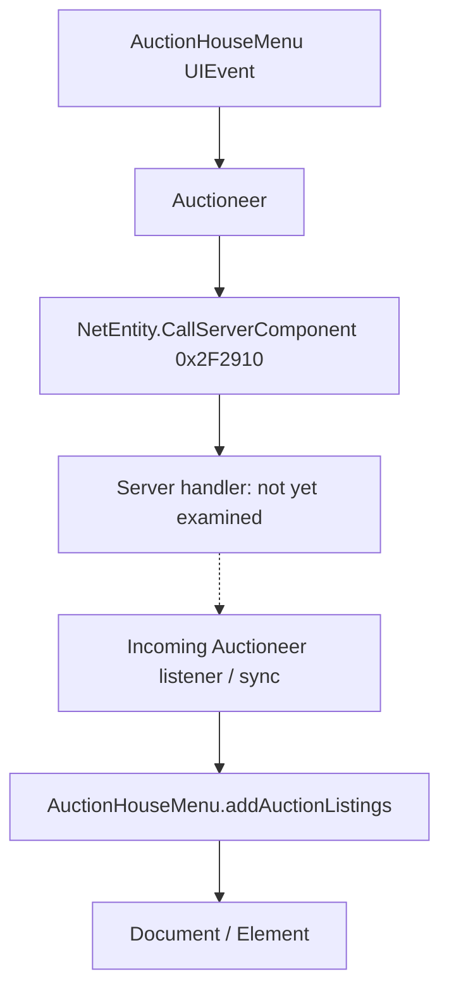

# Batch 04 deep research — interfaces, auctions, navigation and rendering

**Research date:** 2026-11-08. **Source:** privately held user-generated Ghidra export of OrbusVR `GameAssembly.dll`, **function ordinals 30,001–40,000** (RVA range approximately `0x678CB0`–`0x979B00`). Image base **`0x180000000`**. Game binary fingerprint/build **unverified**. This page is **static research**, not proof of behavior on every game build or server.

This is a guide for people making **UI mods, inventory panels, economy tools, accessible input systems, navigation/camera utilities and multiplayer replays**. The linked articles contain named RVAs, call paths, data fields, limitations and test plans.

## Source audit

| Metric | Value |
|---|---:|
| Functions indexed in Batch 04 | **10,000** |
| Successfully decompiled | **9,999** |
| Failed to decompile | **1**, function #30,475, RVA **`0x696A60`** (timeout) |
| Private pseudocode characters indexed | **14,725,507** |
| Distinct syntactically visible direct call pairs | **58,343** |
| Call pairs with callee resolved *inside Batch 04* | **6,855** |
| Unique directly called native addresses | **6,040** |
| Selected metadata reference | [**140 method declarations in 20 classes**](../references/batch-04-curated-methods.json) |

**Coverage interpretation:** these totals show that every exported function in the ordinal range has been indexed, **not** that we understand or have runtime-tested every function. Most exported native labels are anonymous `FUN_...`. Selected managed names are from the matching IL2CPP snapshot, and several vendor SDK packages may be present but not actually used by Orbus gameplay.

## Deep guides

| Area | Guide | Main evidence |
|---|---|---|
| Auctions and transactions | [Auctioneer, market searches, bidding and listing UI](batch-04-auction-market-contracts.md) | Four distinct Auctioneer outgoing request IDs; callbacks and listing renderer; auction-posting input arrays |
| Navigation | [TerrainGrid, TerrainCell, NavMesh and collision checks](batch-04-terrain-grid-and-navigation.md) | `GridMoved`, `NavMesh.SamplePosition`, physics raycasts, grid-display mesh and movement validity |
| Native interface | [PowerUI loot, notifications, keyboard and object choices](batch-04-powerui-menus-notifications-and-keyboard.md) | `Document`/`Element` updates, native keyboard state, notification animation callbacks |
| Item data | [InventoryItemInstance and InventoryItemMeta field reference](batch-04-item-stat-and-loot-data-reference.md) | Real item/upgrade/stats/durability/rarity fields plus loot renderer integration |
| Rendering and bundled libraries | [Impostor cache, Oculus Avatar SDK and A*](batch-04-rendering-impostors-avatars-and-pathfinding-libraries.md) | Render-texture/quad proxy management; SDK pose methods; cautions about unproven game integration |

## The biggest useful findings

### 1. Auction requests are component-scoped, not universal market commands

In the inspected build, `Auctioneer.callServerItemSearch` **`0x77B120`** sends method **1**, category search **`0x77B020`** method **2**, `Bid` **`0x77A650`** method **3**, and `marketBuyout` **`0x77B220`** method **4**. The auction-result callback `0x782C40` feeds `AuctionHouseMenu.addAuctionListings` **`0x7731C0`**. A client request or refreshed listing does not confirm a successful purchase. `AuctionPostMenu.postItem` **`0x7790C0`** parses two **12-element** integer price arrays and invokes `AuctionChest.PostItem` **`0x65A830`** (Batch 03). Do not infer server listing limits from client form length.

### 2. The terrain “grid” is local movement/navmesh logic, not distant scenery

`TerrainGrid.GridMoved` **`0x6D73A0`** calls Unity `NavMesh.SamplePosition` (snapshot RVA **`0x1417A30`**) with **2.0** max sample distance. `TerrainCell.doCheck` **`0x6D5C80`** uses Unity Physics and NavMesh raycasts to cache height and cell validity. `TerrainGrid.CreateMesh` **`0x6D6F60`** generates a **navigation/grid overlay mesh**, not terrain assets. A spectator cannot reconstruct missing dungeon floors just by calling `CreateMesh`. This removes a misleading RebornCamera investigation path and points back to the real scene/asset loader and server interest manager.

### 3. UI mod authors have concrete native DOM entry points

`LootMenu.addItemToList` **`0x87F1A0`** appends item markup to a `Document` element, with branches for rarity, stack count, attack and armor. `NotificationMenu.ShowNotification` **`0x6F9D60`** changes alert DOM and schedules animation callbacks, with visible **0.5** and **5.5-second** timing constants. `KeyboardMenu` has shared/static shift/alt/input flags; `ObjectOptionMenu` uses `Document`/`UIEvent` and choice-class metadata. These can inspire ModCore-like native integration, but element ownership/focus and game build must be tested before relying on direct calls.

### 4. The item model explicitly exposes stats the stock loot line doesn't necessarily show

`ExtUI.InventoryItemInstance` provides `itemLevel` `+0x60`, `itemPlusLevel` `+0x64`, `rarity` `+0x68`, `currentDurability` `+0x1C`, `maxDurability` `+0x5C`, attack/armor and numerous attributes. `InventoryItemMeta` carries affixes, dyes, shard identifiers, enhancement/appearance metadata, etc. The original item-serialization methods belong to a *different batch*, so they require a separate native trace. **Displaying** a client's item fields is not **editing** the authoritative server inventory.

### 5. An impostor system exists, but whether gameplay uses it is unresolved

`ImposterManager` holds a camera, impostor-render camera, render-texture caches and proxies. Its `getRenderTexture` **`0x7F4B70`**, `giveBackRenderTexture` **`0x7F4D10`** and `garbageCollect` **`0x7F4970`** form a camera-dependent render-resource lifecycle. Separately, Oculus `OvrAvatarRemoteDriver` and `OvrAvatarPacket` types exist. Their **presence alone does not prove** they drive Orbus's `OtherPlayerEntity` networking or all distant terrain/trees. The game-specific remote player update is traced in [Batch 02](batch-02-incoming-message-parser-and-spawns.md).

## Follow-up research needed

1. **Server-side marketplace handlers:** actual currency deduction, validation, listing expiry and authoritative state. Do not infer these from Auctioneer sends.
2. **Icon resolution:** which base-item ID, UI class or sprite atlas resolves an item picture; useful for GameMaster and inventory mods.
3. **UI lifecycle:** exact menu `Document` ownership, DOM selector strings, native keyboard submit callback and menu reopen behavior.
4. **RebornCamera:** confirm which objects use impostors in the live scene; investigate actual scene/asset streaming and server entity interest separately.
5. **Inventory construction:** trace `InventoryItemInstance(string)` **`0x14315F0`** and `GetAppearanceId` **`0x142EDD0`** in Batch 8, and verify effective stats vs `InventoryItemMeta`.
6. **Retry** the one timed-out method **`0x696A60`** in Ghidra with a longer timeout; do not fabricate behavior.
7. **Runtime reproduction** of all statically traced methods in an authorized private game/server build.

## Publishing and AI-assistant guidance

The research repository contains **independent explanations, the small curated method reference, unresolved questions and test plans**. It does **not** contain complete proprietary decompiled game code. Researchers with their own legally obtained binary can use the [offline Ghidra metadata audit](../tools/ghidra_export_audit_README.md) and the private search-index workflow to validate names/addresses and investigate additional callers. Read the [research standard](batch-research-standard.md) before calling a method a supported modding API.

**Research status:** major Batch 04 subsystems have detailed **static traces**, but this is *not* an exhaustive analysis of 10,000 functions or runtime verification.
